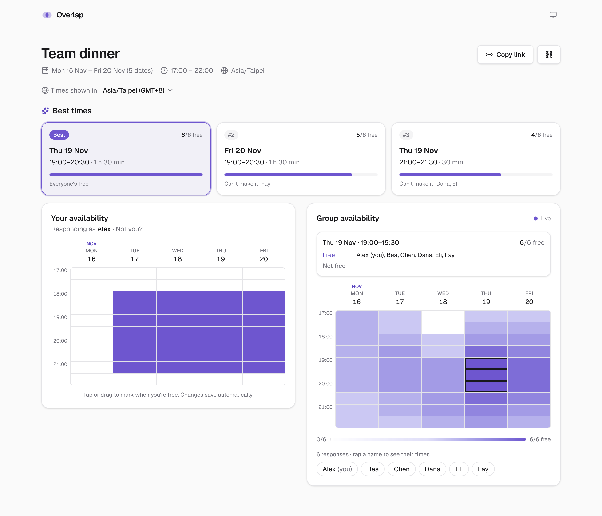
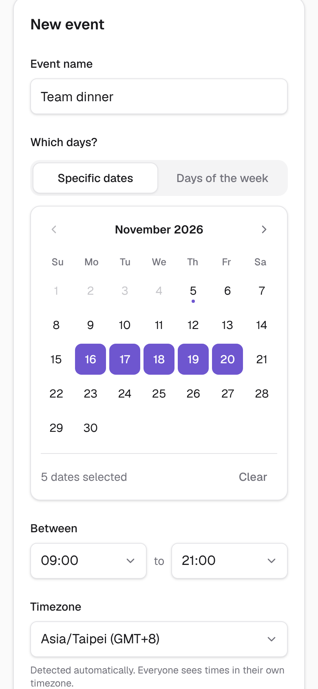
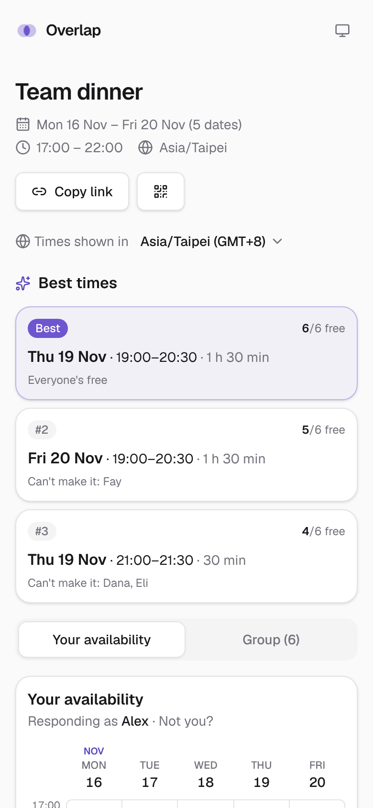
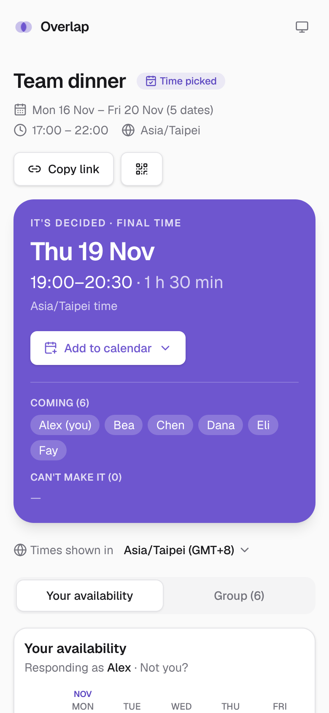

<p align="center">
  
</p>

<h1 align="center">Overlap</h1>

<p align="center">
  <strong>Find the time that works for everyone.</strong><br />
  Share a link, paint your free time, and see when the whole group overlaps — live.<br />
  No sign-ups, no back-and-forth.
</p>

<p align="center">
  <a href="https://overlapping.day"><strong>Try it → overlapping.day</strong></a>
</p>

<picture>
  <source media="(prefers-color-scheme: dark)" srcset="docs/screenshots/event-dark.png" />
  
</picture>

## How it works

1. **Create an event.** Give it a name, pick specific dates or days of the
   week, and set a time range. You get two links: a short one to share, like
   `/e/x7k2pq`, and a private organiser link. Send the organiser link to
   yourself (LINE Keep, Notes or email) to manage the event from any device.
2. **Share the link.** Copy it, show a QR code, or send it straight from your
   phone's share sheet.
3. **Everyone paints their availability.** Enter a name, then click or drag
   across the grid. It saves as you go.
4. **See the overlap.** The heatmap shows where people overlap, and **Best times**
   lists the top three slots and who can't make each one.
5. **Close the event.** The organiser picks the final time, from Best times or
   any other slot. Everyone instantly sees it in their own timezone, with who's
   coming, and adds it to their calendar in one tap. Answers lock; changed your
   mind? Reopen it.

<table>
  <tr>
    <td width="33%"></td>
    <td width="33%"></td>
    <td width="33%"></td>
  </tr>
  <tr>
    <td align="center">Create</td>
    <td align="center">Best times</td>
    <td align="center">Final time</td>
  </tr>
</table>

## Features

- **Drag to paint.** Mark your free time with a mouse, finger or keyboard.
  Changes save automatically.
- **Group heatmap.** Darker means more people are free. Hover or tap any slot to
  see exactly who can and can't make it, or tap a name to see one person's times.
- **Best times.** The top three time ranges where the most people are free,
  updated as answers come in.
- **Close the event.** The organiser announces the final time with one tap. It
  appears for everyone at once, with who's free and who can't make it, and can
  be reopened if plans change.
- **Add to calendar.** Google Calendar, Apple Calendar or Outlook, with the
  event link and who's coming. Weekday events repeat every week.
- **Live updates.** When someone joins or changes their answers, everyone's
  screen updates instantly.
- **Every timezone.** Times are shown in each viewer's own timezone, even when
  that splits a day across midnight.
- **No accounts.** Just a name. Add an optional 4-digit PIN so nobody else can
  edit your answers. The home page lists the events you've created or joined
  on this device.
- **Easy to share.** Copy link, QR code, and link previews for LINE, Slack and
  iMessage (Chinese event names included).
- **Made for phones.** Mobile-first layout, light and dark mode, and keyboard
  accessible. Long events page through a week at a time.

## Privacy

- **Page views** are counted with [Vercel Web Analytics](https://vercel.com/docs/analytics):
  which page was opened, the referring site, and your country, browser,
  operating system and device type. It uses no cookies. Before anything is
  sent, organiser tokens and event codes are removed from the page address.
- **Nothing else is tracked.** No other analytics, no ads, no third-party
  trackers.
- What you type into an event (your name, your availability and an optional
  PIN, stored only as a hash) is used to run that event. Your browser also
  remembers which participant you are, your organiser token if you organise,
  and your list of events. These stay on your device.

---

## For developers

Built with Next.js (App Router) · TypeScript · Tailwind CSS · Supabase
(Postgres + Realtime) · deployed on Vercel.

### How it fits together

- **The browser never talks to the database directly.** Pages load data on the
  server, and every write goes through a Server Action (`app/actions.ts`) that
  validates the input first.
- **Row Level Security is on with no policies**, so the public (publishable)
  key can't read or write anything. Only the server, using the secret key, can.
- Times are stored in the event's own timezone and converted to each viewer's
  timezone for display (`lib/slots.ts`).
- **Organisers have no account either.** Creating an event returns a random
  32-character token; only its SHA-256 hash is stored. It travels in the
  organiser link's fragment (`/e/<slug>#host=…`), which browsers never send to
  the server, and is then kept in localStorage.
- **Add to calendar** needs no API keys: Google Calendar and Outlook get
  pre-filled links, and `/e/<slug>/calendar.ics` serves an .ics file for Apple
  Calendar and others (`lib/calendar.ts`).
- **Live updates** come from a Postgres trigger that sends a Realtime broadcast
  on `event:<id>` whenever someone joins or saves. Browsers only listen.

### Run it locally

You need Node.js 20.9 or newer.

```bash
git clone https://github.com/HsiaoLiang/Overlap.git
cd Overlap
npm install
cp .env.example .env.local   # then fill in the values (see Supabase setup)
npm run dev
```

Open http://localhost:3000.

### Supabase setup

1. Go to [supabase.com](https://supabase.com), sign in, and click **New project**.
   - Name: `overlap`. Pick a strong database password and save it somewhere.
   - Region: the one closest to your users (e.g. Tokyo or Singapore for Taiwan).
   - Leave **Data API** enabled.
2. When the project is ready, open **SQL Editor → New query**, paste the
   contents of `supabase/migrations/001_tables.sql`, and click **Run**.
   You should see "Success. No rows returned".
3. Open **Project Settings → API Keys** and copy:
   - the **publishable** key (`sb_publishable_…`) → `NEXT_PUBLIC_SUPABASE_PUBLISHABLE_KEY`
   - the **secret** key (`sb_secret_…`) → `SUPABASE_SECRET_KEY`
4. Copy the **Project URL** (`https://<id>.supabase.co`, shown under
   **Project Settings → Data API** or the **Connect** button) →
   `NEXT_PUBLIC_SUPABASE_URL`.

Run each new file in `supabase/migrations/` the same way, in order, as later
steps add them:

- `001_tables.sql` — tables and security
- `002_realtime.sql` — live updates (a trigger that broadcasts every join/save)
- `003_finalise.sql` — organiser token, final time, and a trigger that
  broadcasts when the event is closed or reopened

For weekly numbers (events created, participants, how many events reach 3+
people or get closed), paste `supabase/queries/stats.sql` into the SQL Editor.
It only reads data.

If the group view says **Connecting…** forever, check **Realtime → Settings**
in Supabase and make sure public channels are allowed.

### Deploy on Vercel

1. In Vercel, **Add New → Project** and import this repository.
2. Add the three environment variables from `.env.example`.
3. Deploy. Then, under **Settings → Functions → Function Region**, pick the
   region closest to your Supabase project and redeploy.
4. Open the project's **Analytics** tab and enable **Web Analytics** to count
   page views.

Every push to `main` deploys automatically.

### Troubleshooting

- **Styles look out of date in `npm run dev`:** stop the server, delete the
  `.next` folder, and start it again. (Production builds aren't affected.)
- **Group view stuck on "Connecting…":** see the Realtime note above.

### Scripts

| Command         | What it does                 |
| --------------- | ---------------------------- |
| `npm run dev`   | Start the dev server         |
| `npm run build` | Production build             |
| `npm run lint`  | Lint                         |
| `npm test`      | Unit tests (timezone logic)  |
